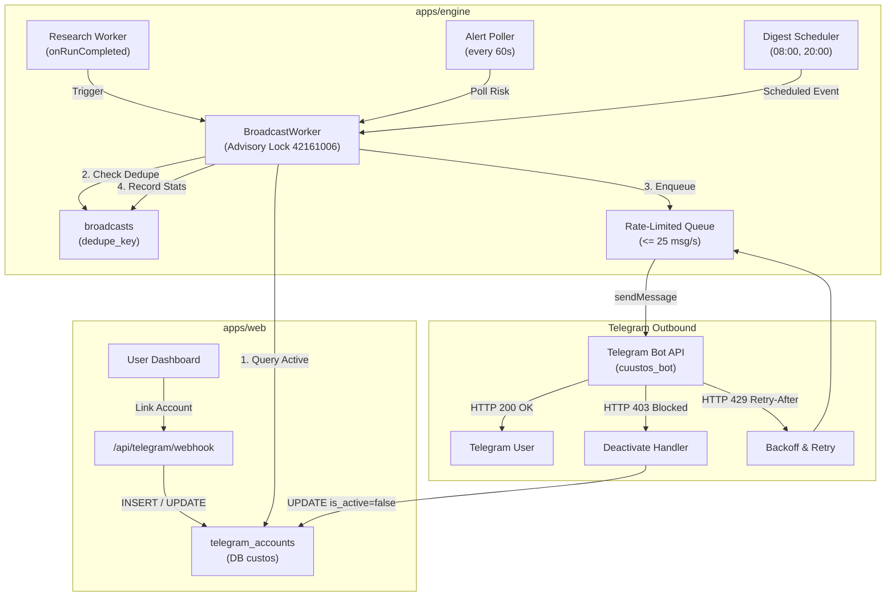

# Spec: Outbound Research Broadcast — Notifikasi & Digest Telegram Terjadwal

- **Milestone:** M1 "Notifikasi Telegram dari server (bukan dari browser)" + M2 "Dry-run: tampilkan rekomendasi … di Telegram" ([PRD §10](../prd.md#10-roadmap-eksekusi))
- **Status:** Approved (arahan user, 2026-10-23)
- **Pemilik:** Tim Engine
- **Terkait:** [ADR 0012](../decisions/0012-unified-db-outbound-research-broadcast.md), [ADR 0002](../decisions/0002-ai-advises-rules-decide.md), [PRD §2, §7, §11](../prd.md), [security.md](../security.md), [m3-channel-gateway-telegram.md](m3-channel-gateway-telegram.md), [research-broadcast plan](../plans/research-broadcast.md)

## 1. Tujuan

Menyediakan layanan pengiriman notifikasi dan ringkasan riset risiko satu arah (outbound-only broadcast) dari Core Risk Engine ke bot Telegram resmi (`cuustos_bot`) untuk seluruh borrower terdaftar.

Layanan ini menggantikan arsitektur gateway inbound terdahulu ([m3-channel-gateway-telegram.md](m3-channel-gateway-telegram.md)) dengan arsitektur broadcast terpadu yang memanfaatkan database kanonik web (`custos`). Engine membaca daftar pengguna aktif (`telegram_accounts`) secara langsung dari database dan mengirimkan ringkasan risiko harian (digest) pada jam yang ditentukan, serta mengirimkan alert proaktif seketika saat terdeteksi kenaikan regime risiko atau anomali kritis (sequencer Arbitrum mati, stablecoin depeg, reserve pool mengering, deviasi oracle). Seluruh proses berjalan tanpa membuka antarmuka chat masuk (inbound) atau eksekusi on-chain pada engine.

## 2. Scope

**Termasuk:**
- **Penerima Notifikasi (Recipients):** Query langsung ke database kanonik untuk mengambil seluruh baris unik (`telegram_user_id`) dari tabel `telegram_accounts` yang berstatus aktif (`is_active = true`).
- **Jadwal Digest Harian:** Pengiriman berkala ringkasan riset & fusion pada jam tetap setiap hari, dikendalikan oleh variabel lingkungan:
  - `BROADCAST_ENABLED`: menyalakan/mematikan worker broadcast (default: `"true"`).
  - `BROADCAST_DIGEST_TIMES`: jadwal jam pengiriman dalam format jam 24 jam dipisahkan koma (default: `"08:00,20:00"`).
  - `BROADCAST_TZ`: zona waktu rujukan untuk penjadwalan (default: `"Asia/Jakarta"`).
  - `BROADCAST_LANG`: bahasa utama pengiriman pesan (default: `"id"`, opsi: `"en"`).
- **Deteksi Alert Risiko Segera:** Porting mesin evaluasi deterministik dari `apps/engine/src/gateway/alerts.ts`:
  - Perubahan regime aset naik (mis. `CALM` → `ELEVATED`, `ELEVATED` → `STRESSED`, `STRESSED` → `CRISIS`) dikirim seketika.
  - Perubahan regime aset turun hanya dikirim setelah kondisi stabil bertahan minimal 1 jam (mekanisme hysteresis `HYSTERESIS_DOWN_HOLD_MS = 3600000`).
  - Sinyal deterministik kritis yang memicu alert segera:
    - `ORACLE T10`: Arbitrum sequencer down.
    - `ONCHAIN T4`: Stablecoin depeg.
    - `T7`: Reserve liquidity pool menipis / utilisasi pool ≥ 98%.
    - `ORACLE T8`: Deviasi / keterlambatan oracle dengan tingkat keparahan tinggi (`severity >= 0.6`).
  - Logika deduplikasi: alert dengan key yang sama tidak dikirim ulang dalam jendela 6 jam (`DEFAULT_DEDUPE_HOURS = 6`), kecuali terjadi eskalasi severity.
- **Tabel Database `broadcasts`:**
  - Pembuatan tabel baru di `@tahansoe/db` untuk melacak histori pengiriman dan status deduplikasi:
    - `id`: UUID primary key (`defaultRandom()`).
    - `kind`: Jenis broadcast (`"digest"` | `"regime"` | `"signal"`).
    - `dedupe_key`: Kunci unik teks untuk mencegah pengiriman ganda (`uniqueIndex`).
    - `message`: Payload konten pesan dalam format HTML Telegram.
    - `recipients_count`: Jumlah penerima yang ditargetkan pada putaran tersebut.
    - `sent_count`: Jumlah pesan yang berhasil dikirim.
    - `failed_count`: Jumlah pesan yang gagal dikirim.
    - `created_at`: Waktu pencatatan broadcast dengan timezone (`defaultNow()`).
- **Rate Limiting & Penanganan Galat Telegram:**
  - Pembatasan laju pengiriman global maksimal **25 pesan per detik** (di bawah batas 30 msg/s Telegram Bot API).
  - Penanganan HTTP 429 (*Too Many Requests*): membaca parameter `retry_after` dan menahan antrean secara asinkron.
  - Penanganan HTTP 403 (*Forbidden / bot was blocked by the user / chat not found*): menandai akun pengguna terkait menjadi tidak aktif (`telegram_accounts.is_active = false`).
  - Kegagalan pengiriman ke satu penerima tidak membatalkan atau menghentikan pengiriman ke penerima lainnya dalam batch.
- **Single-Worker Concurrency (Advisory Lock):**
  - Menggunakan PostgreSQL session advisory lock dengan ID konstan `42161006` (`42161` Arbitrum chain ID + `006` sub-identifier) untuk menjamin hanya ada satu instance `BroadcastWorker` yang aktif saat engine dijalankan dalam mode cluster/multi-proses.
- **Antarmuka CLI:**
  - `tahansoe broadcast digest [--dry]`: menjalankan pengiriman digest secara manual.
  - `tahansoe broadcast once [--dry]`: menjalankan satu siklus evaluasi alert risiko segera.
  - Opsi `--dry`: melakukan simulasi query penerima dan mencetak format pesan ke stdout tanpa memanggil API Telegram.
  - Flag daemon `tahansoe start --no-broadcast`: menjalankan daemon engine tanpa mengaktifkan worker broadcast.
- **Format Teks & Integritas Pesan:**
  - Menggunakan mode parsing HTML Telegram (`<b>`, `<i>`, `<code>`).
  - Seluruh teks dinamis eksternal disanitasi menggunakan `escapeHtml`.
  - Footer wajib pada setiap pesan: `"Informasi risiko · bukan saran investasi"` (id) atau `"informational · not investment advice"` (en).
  - Tanpa rekomendasi transaksi finansial, prediksi arah harga, atau sinyal beli/jual ([PRD §11](../prd.md#11-non-goals)).

**Tidak termasuk:**
- Penanganan pesan masuk (inbound router, webhook listener, atau long polling `getUpdates` di sisi engine).
- Fitur tanya-jawab interaktif AI (Q&A LLM chat) melalui Telegram ([ADR 0012](../decisions/0012-unified-db-outbound-research-broadcast.md)).
- Alur linking akun Telegram melalui bot (`/start <code>` dan `/stop`), yang dikelola sepenuhnya oleh web app di `apps/web/app/api/telegram/webhook`.
- Preferensi notifikasi per-chat di file `settings.json` (preferensi masa depan akan dikonfigurasi melalui dashboard web).
- Transaksi atau eksekusi on-chain langsung dari Telegram ([security.md §1](../security.md#1-invariant)).

## 3. Desain

### 3.1 Arsitektur Alur Data



### 3.2 Modul dan Struktur File

Perubahan kode akan diorganisasikan ke dalam modul-modul berikut:

```
packages/db/
  src/
    schema.ts             # Definisi skema tabel broadcasts
    migrate.ts            # Skrip migrasi Drizzle idempoten

apps/engine/
  src/
    telegram/             # Modul integrasi klien outbound Telegram
      api.ts              # Fungsi API sendMessage, getMe
      queue.ts            # Antrean pengiriman rate-limited (25 msg/s + handling 429)
      sender.ts           # Antarmuka TelegramSender
      views.ts            # Template tampilan HTML pesan (digest, alert, footer)
      formatter.ts        # Sanitasi teks (escapeHtml, clip, badge)
    broadcast/            # Logika orkestrasi broadcast
      worker.ts           # BroadcastWorker (lifecycle, scheduler, advisory lock)
      detector.ts         # Deteksi perubahan regime, sinyal kritis, hysteresis
      recipients.ts       # Query penerima aktif & update status akun tidak aktif
      types.ts            # Definisi tipe payload & konteks broadcast
    cli/
      commands/
        broadcast.ts      # Perintah CLI: tahansoe broadcast digest|once [--dry]
        start.ts          # Integrasi opsi --no-broadcast pada daemon engine
  test/
    broadcast/
      detector.test.ts    # Unit test deteksi regime, hysteresis, dan sinyal kritis
      queue.test.ts       # Test rate limiter, retry 429, dan error isolation
      worker.test.ts      # Test alur broadcast dengan mock database & mock sender
```

### 3.3 Skema Database (`broadcasts`)

Tabel `broadcasts` ditambahkan pada `packages/db/src/schema.ts`:

```typescript
export const broadcasts = pgTable(
  "broadcasts",
  {
    id: uuid("id").defaultRandom().primaryKey(),
    kind: text("kind").notNull(), // 'digest' | 'regime' | 'signal'
    dedupeKey: text("dedupe_key").notNull(),
    message: text("message").notNull(),
    recipientsCount: integer("recipients_count").notNull().default(0),
    sentCount: integer("sent_count").notNull().default(0),
    failedCount: integer("failed_count").notNull().default(0),
    createdAt: timestamp("created_at", { withTimezone: true })
      .notNull()
      .defaultNow(),
  },
  (t) => ({
    dedupeKeyUnique: uniqueIndex("broadcasts_dedupe_key_unique").on(t.dedupeKey),
    createdAtIdx: index("broadcasts_created_at_idx").on(t.createdAt),
  })
);
```

### 3.4 Aturan Evaluasi Alert & Logika Deduplikasi

Deteksi alert risiko proaktif berjalan setiap 60 detik atau segera setelah siklus riset selesai (`onRunCompleted`):

| Jenis Alert | Kondisi Pemicu | Format Pesan Utama | Dedupe Key |
|---|---|---|---|
| **Regime Naik** | `currentLevel > prevLevel` (misal `CALM` → `ELEVATED` / `STRESSED` / `CRISIS`) | `⚠️ {ASSET}: {FROM} → {TO}` + Penjelasan pemicu on-chain | `alert:regime:{asset}:{regime}` |
| **Regime Turun** | `currentLevel < prevLevel` setelah bertahan di level tinggi selama ≥ 1 jam (`HYSTERESIS_DOWN_HOLD_MS`) | `✅ {ASSET} kembali ke {TO}` + Konfirmasi kondisi stabil | `alert:regime:{asset}:{regime}` |
| **Sequencer Down** | Sinyal `module: "ORACLE"` dengan path `T10` | `🚨 Sequencer Arbitrum DOWN — transaksi repay tertahan` | `alert:signal:{dedupeKey}` |
| **Stablecoin Depeg** | Sinyal `module: "ONCHAIN"` dengan path `T4` | `🚨 Stablecoin {asset} depeg terdeteksi di oracle` | `alert:signal:{dedupeKey}` |
| **Pool Kering** | Sinyal path `T7` atau utilisasi pool reserve ≥ 98% | `⚠️ Pool {asset} likuiditas menipis (utilisasi ≥ 98%)` | `alert:signal:{dedupeKey}` |
| **Oracle Lag Berat** | Sinyal `module: "ORACLE"` dengan path `T8` dan `severity >= 0.6` | `🚨 Deviasi harga oracle Aave vs pasar pada {asset}` | `alert:signal:{dedupeKey}` |
| **Digest Terjadwal** | Waktu lokal mencocokkan jam pada `BROADCAST_DIGEST_TIMES` (08:00 / 20:00) | `📅 Ringkasan risiko harian ({DATE})` + Ringkasan AI & assessment | `digest:{YYYY-MM-DD}:{HH:mm}` |

**Aturan Deduplikasi:**
- Untuk alert regime dan sinyal kritis, status pengiriman dicek terhadap tabel `broadcasts`. Jika `dedupe_key` sudah tercatat dalam 6 jam terakhir (`DEFAULT_DEDUPE_HOURS`), alert diabaikan kecuali tingkat keparahan (*severity*) mengalami peningkatan.
- Untuk digest harian, format key menggunakan tanggal dan jam penjadwalan (`digest:YYYY-MM-DD:08:00`), sehingga dijamin hanya terkirim sekali per slot waktu.

### 3.5 Mekanisme Pengiriman dan Penanganan Error

1. **Pengambilan Penerima:**
   ```sql
   SELECT DISTINCT telegram_user_id
   FROM telegram_accounts
   WHERE is_active = true;
   ```
2. **Antrean Rate-Limited:**
   - Seluruh payload pesan diserahkan ke `TelegramQueue`.
   - Token bucket / delay konstan menjamin jeda antar-pesan minimal 40 ms (maksimal 25 pesan/detik).
3. **Penanganan Error Respons:**
   - **Status 200:** Tingkatkan counter `sent_count`.
   - **Status 429 Too Many Requests:**
     ```typescript
     const retryAfterSec = response.parameters?.retry_after ?? 5;
     await sleep(retryAfterSec * 1000);
     // Lakukan percobaan ulang untuk pesan terkait
     ```
   - **Status 403 Forbidden / Chat Not Found:**
     Pesan menandakan bot telah diblokir atau chat dihapus oleh user. Sistem segera mengeksekusi:
     ```sql
     UPDATE telegram_accounts
     SET is_active = false
     WHERE telegram_user_id = $1;
     ```
     Tingkatkan counter `failed_count` dan lanjutkan ke penerima berikutnya.
   - **Error Jaringan / Timeout:**
     Catat log kesalahan, tingkatkan counter `failed_count`, dan jangan gagalkan penerima lain.

### 3.6 Konfigurasi Lingkungan (`.env`)

Variabel konfigurasi berikut didukung pada `apps/engine/.env`:

| Variabel | Tipe | Default | Penjelasan |
|---|---|---|---|
| `BROADCAST_ENABLED` | boolean | `true` | Menyalakan atau mematikan modul broadcast di dalam engine. |
| `BROADCAST_DIGEST_TIMES` | string | `08:00,20:00` | Daftar waktu pengiriman digest harian (format 24 jam, dipisahkan koma). |
| `BROADCAST_TZ` | string | `Asia/Jakarta` | Zona waktu IANA untuk evaluasi jam pengiriman digest. |
| `BROADCAST_LANG` | string | `id` | Bahasa konten template pesan (`id` atau `en`). |
| `TELEGRAM_BOT_TOKEN` | string | *(wajib)* | Token bot Telegram resmi dari BotFather (sama dengan web app). |
| `DATABASE_URL` | string | *(wajib)* | URL koneksi basis data Postgres kanonik (`custos`). |

## 4. Dampak Keamanan

Pemeriksaan kepatuhan terhadap checklist keamanan ([security.md §4](../security.md#4-checklist-review-keamanan)):

1. **Jalur perpindahan token baru (I1):** Tidak ada. Modul broadcast murni beroperasi di layer komunikasi off-chain dan tidak berinteraksi dengan smart contract.
2. **Role / admin / hak istimewa baru (I2):** Tidak ada role atau admin baru yang ditambahkan ke Guardian.
3. **Pengaruh AI ke luar batas band (I3):** Output AI (ringkasan riset) hanya disajikan sebagai informasi kontekstual kepada pengguna; AI tidak memiliki wewenang eksekusi on-chain.
4. **Dampak terburuk bila komponen dikompromi (I4):** Jika token bot Telegram atau worker broadcast diretas, dampak terburuk terbatas pada spam pesan atau disinformasi notifikasi Telegram. Tidak ada saldo atau aset yang dapat dicuri atau dipindahkan dari pengguna.
5. **Sumber harga keputusan eksekusi (I5):** Informasi harga pada alert mengacu pada data oracle protokol atau pemantau sinyal, namun tidak mengubah invariant bahwa eksekusi proteksi on-chain tetap diatur oleh rule engine deterministik via oracle target.
6. **Perilaku saat komponen mati atau data basi (I6):** Jika worker broadcast mati, fungsi inti Core Risk Engine, evaluasi fusion, dan sentinel guardian tetap berjalan normal. Jika data riset kedaluwarsa, digest tidak akan mengirimkan data basi.
7. **Kendali pengguna atas sistem (I7):** Pengguna dapat mematikan penerimaan notifikasi kapan saja melalui perintah `/stop` ke bot Telegram atau melalui dashboard web.
8. **Rahasia dan kredensial (I8):** `TELEGRAM_BOT_TOKEN` dan `DATABASE_URL` hanya dibaca dari environment variables. Token bot disamarkan pada log dan tidak pernah dicetak ke terminal atau pesan chat.
9. **Sanitasi konten eksternal:** Seluruh input dinamis (judul berita, nama aset, penjelasan model riset) difilter melalui fungsi `escapeHtml` untuk mencegah HTML injection pada klien Telegram.

## 5. Kriteria Penerimaan

- [ ] Skema database `broadcasts` dibuat secara idempoten di `@tahansoe/db` dengan index unik pada `dedupe_key`.
- [ ] Engine dapat membaca seluruh penerima unik dari `telegram_accounts` yang berstatus `is_active = true` pada basis data kanonik web.
- [ ] Perintah CLI `tahansoe broadcast digest --dry` mencetak daftar penerima dan pratinjau pesan HTML yang valid tanpa error.
- [ ] Perintah CLI `tahansoe broadcast once --dry` mengevaluasi kondisi alert saat ini dan menampilkan hasil evaluasi tanpa error.
- [ ] Digest harian terkirim pada waktu yang telah ditentukan (`BROADCAST_DIGEST_TIMES`) sesuai zona waktu `BROADCAST_TZ`.
- [ ] Kenaikan regime aset memicu pengiriman alert segera ke seluruh penerima aktif.
- [ ] Penurunan regime aset menaati jeda hysteresis minimal 1 jam sebelum mengirimkan notifikasi normalisasi.
- [ ] Sinyal kritis T10, T4, T7, dan T8 (severity ≥ 0.6) memicu pengiriman alert proaktif segera.
- [ ] Alert yang sama tidak dikirim berulang dalam kurun waktu 6 jam, kecuali tingkat severity meningkat.
- [ ] Rate limit Telegram ditaati (maksimal 25 pesan/detik), dan respons HTTP 429 menangani parameter `retry_after` secara otomatis.
- [ ] Respons HTTP 403 (user memblokir bot / chat not found) secara otomatis mengubah baris pengguna menjadi `is_active = false` di `telegram_accounts`.
- [ ] Kegagalan pengiriman ke salah satu akun tidak membatalkan pengiriman ke akun-akun lainnya dalam batch broadcast.
- [ ] Session advisory lock Postgres `42161006` mencegah eksekusi ganda antar-proses worker.
- [ ] Flag `tahansoe start --no-broadcast` berhasil menonaktifkan inisialisasi broadcast worker pada daemon engine.
- [ ] Seluruh pesan broadcast mencantumkan footer wajib dan bebas dari rekomendasi investasi atau prediksi harga.

## 6. Rencana Test

1. **Unit Tests:**
   - `detector.test.ts`: Verifikasi transisi regime naik (langsung terpicu), regime turun (hanya setelah 1 jam), deteksi sinyal T10/T4/T7/T8, dan evaluasi dedupe key.
   - `views.test.ts`: Verifikasi output HTML dari `dailySummaryView`, `reportView`, dan alert templates; verifikasi kepatuhan tag HTML terbuka/tertutup per baris dan keberadaan footer wajib.
   - `queue.test.ts`: Uji mekanisme rate limiter (memastikan frekuensi ≤ 25 msg/s), penanganan status HTTP 429 dengan backoff sleep, serta isolasi galat pada kegagalan individual.
   - `recipients.test.ts`: Verifikasi query pemilihan user aktif dan fungsi nonaktifkan akun saat menerima kode error 403.
2. **Integration Tests:**
   - Uji alur `BroadcastWorker` menggunakan mock klien Telegram (`TelegramSender` palsu) dan basis data Postgres pengujian (atau test container).
   - Pengujian CLI subcommand `tahansoe broadcast digest --dry` dan `tahansoe broadcast once --dry` terhadap state tiruan.
3. **Manual / Live Smoke Test:**
   - Jalankan `tahansoe broadcast digest --dry` pada terminal staging untuk memvalidasi koneksi ke DB web dan penghitungan jumlah user.
   - Uji pengiriman nyata ke satu akun Telegram uji pengembang dengan izin eksplisit.

## 7. Pertanyaan Terbuka

- **Preferensi bahasa dan filter aset per pengguna:** Di masa depan, apakah pengguna dapat memilih bahasa notifikasi (`id` vs `en`) atau memfilter aset jaminan/utang tertentu secara mandiri dari UI dashboard web? (Dicatat di backlog [plan riset broadcast §5](../plans/research-broadcast.md#5-backlog-di-luar-scope)).
- **Personalisasi notifikasi posisi:** Apakah broadcast perlu disegmentasikan berdasarkan komposisi aset jaminan atau utang aktif pengguna tertentu, alih-alih broadcast seragam ke semua pengguna? (Dicatat di backlog).
